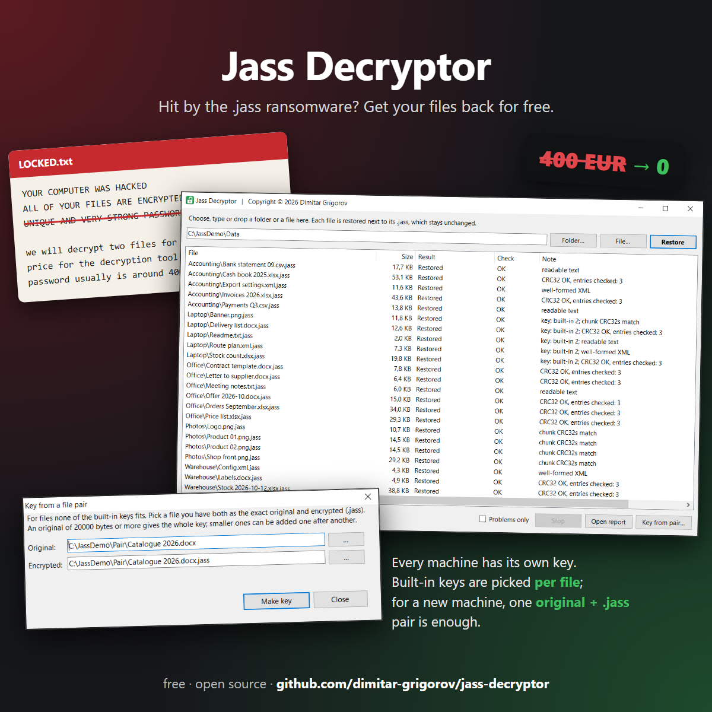
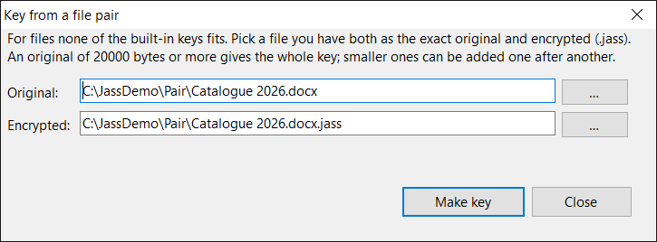

# Jass Decryptor

**Files encrypted by the `.jass` ransomware? You can get them back for free.**

<p align="center">
  
</p>

Pick a folder, press **Restore**: every file comes back next to its `.jass`, checked, and the `.jass` files stay untouched. A whole business got its data back the same day. Nobody paid.

## ⬇ [Download JassDecryptor.exe](https://github.com/dimitar-grigorov/jass-decryptor/releases/latest/download/JassDecryptor.exe)

One file, nothing to install, Windows 8 or later. The SHA-256 checksum and older versions are on the [releases page](https://github.com/dimitar-grigorov/jass-decryptor/releases/latest).

## Is this your ransomware?

- Your files have a new extension: `report.pdf` became `report.pdf.jass`.
- A note named `LOCKED.txt` appeared:

```
YOUR COMPUTER WAS HACKED
ALL OF YOUR FILES ARE ENCRYPTED WITH UNIQUE AND VERY STRONG PASSWORD

Download and install Tor browser and navigate to http://slkbkfxzsh43wgmnm4t6gtiewrzojxoo2xmu4vdpsu2cdfzgyq76saqd.onion/

we will decrypt two files for free
price for the decryption tool and the password usually is around 400eur
```

- Their Tor chat asks for a "personal ID" and offers to decrypt two files as proof.

If this matches, try the tool before you pay anything.

## The "very strong password" isn't

Only the first 20000 bytes of each file are scrambled and the rest is left as it was. The key is the same for every file on a machine but differs between machines. The tool carries every key known so far, each proved byte for byte, and picks the one that fits each file: SQL Server databases, archives, PDFs and spreadsheets come back and pass their own checksums.

## How to use it

1. Download `JassDecryptor.exe` and run it.
2. Choose a folder or a single file (or drop it onto the window) and press **Restore**.
3. Every `name.jass` is restored next to itself as `name`. The `.jass` files are not changed.

If a file with that name already exists:
- **same content**: it is left alone;
- **different**: you see both sizes and choose **keep both** (saved as `name (recovered)`), **replace** (the old one becomes `name (old)`, nothing is deleted) or **skip**.

Before writing anything, the tool tests its keys on a few of your files. If none fits, it stops and writes nothing; see [Different key?](#different-key) below. A CSV report of every file goes to `JassDecryptor-reports` next to the exe. For scripts and many machines there is a [command line](#command-line) mode.

## After the recovery

- Keep the `.jass` files until you have opened the important restored ones.
- Change every password and close remote access (RDP, AnyDesk and the like). That is most likely how they got in.
- Reinstall the machine if you can. Do not run "decryptors" from unknown sources.

## Different key?

You need one file that you have both as an exact original and encrypted: an installer, a PDF from an e-mail, a template, or a file that was open while the ransomware ran (it often leaves `name` next to `name.jass`). Ideally 20000 bytes or larger; smaller pairs can be combined.

Press **Key from pair…**, pick the two files and press **Make key**. The key is saved as `jass_keystream_20000.bin` next to the exe and used from then on, together with the built-in ones.

<p align="center"></p>

The same from a script:

```
python python/derive_keystream.py jass_keystream_20000.bin <original> <original>.jass
```

An older version of a file is not an original: wherever its content changed, the key comes out wrong.

Stuck? Open an issue, with one non-sensitive original/encrypted pair if you can share it.

---

## For the technically curious

### How we cracked it

A small business woke up to `*.jass` files. What mattered most was its SQL Server database, and the only backup was an encrypted ZIP.

1. **The tail was intact.** The ZIP's central directory at the end of the file was readable, and the archive was exactly its original size. So only the head was encrypted and nothing was appended: no key, no file ID.
2. **Same pattern everywhere.** A few application files existed both plain (older copies) and encrypted. XOR of each pair was non-zero up to offset 19999 and zero after it, and the pattern was the same for different files. One keystream, 20000 bytes, from offset 0.
3. **The trap.** The first key came from the largest pair, an application database, and was wrong in 6 bytes: the "plain" copy was an older version. The ZIP failed its CRC.
4. **The fix.** Majority voting over many encrypted text files and decompressing the ZIP's deflate stream pinned down those 6 bytes. The backup inside the ZIP now matches its CRC32, a RAR with thousands of files passes `7z t`, and the restored database passes `DBCC CHECKDB WITH DATA_PURITY`.
5. **Result.** Every file came back: databases, PDFs, spreadsheets, archives, application files. Everything that can be checked passes.

Lessons: an "original" must be the exact same version, so compare the bytes after the encrypted zone first. Prove a key on something with checksums, not on how the output looks.

### Keys

| Key | Source | Proof |
|---|---|---|
| `keystream/jass_keystream_20000.bin` | The machine in the story above. | ZIP CRC32, `7z t`, `DBCC CHECKDB`. |
| `keystream/jass_keystream_20000_2.bin` | Another machine. Published first in [Xyntrax's JASS-Decryptor](https://github.com/Xyntrax/JASS-Decryptor), which credits a script by [Rivitna](https://x.com/rivitna2). Thanks to both. | Confirmed here on samples from that machine: an original/encrypted pair covers bytes 0 to 17259, a zlib stream with an Adler-32 checksum in an encrypted PDF covers 11046 to 19999. |

Each file gets the key under which its head matches its extension (ZIP, PDF, Office and so on), is all zeros, or is plain text. Files that cannot tell get the key most other files fit.

### What the tool checks

- **Before:** decrypts the head of sample files with known signatures (ZIP, PDF, PNG, XML, Office, SQL Server backups) with every key. No key fits, no writes.
- **After each file:** CRC32 of ZIP/Office/ODF entries inside the decrypted zone, PNG chunk CRCs, XML parsing, a `7z t` for RAR/7z when 7-Zip is installed (found via registry or PATH; optional), header checks for the rest.
- Writes to a temporary file and renames it, so an interrupted run never leaves a half-written file under the real name. Memory use stays flat on large files.

### Command line

The same exe runs without a window:

```
start /wait JassDecryptor.exe /cli D:\Data /conflict:skip
```

- `/conflict:beside` (default) saves a differing file as `name (recovered).ext`; `replace` renames the existing one to `name (old).ext` first; `skip` leaves it.
- `/force` goes on even if the key check fails. `/?` prints the help.
- One line per file, then a summary and the CSV report path. Output can be redirected to a file. Ctrl+C stops after the current file.
- Exit codes: 0 clean, 1 some files need a look, 2 the key does not fit, 3 the key cannot be loaded, 4 bad arguments or no `.jass` files.
- It is a GUI exe, so an interactive `cmd` does not wait for it: use `start /wait`. Batch files and PowerShell's `Start-Process -Wait` wait by themselves.

### Source

| Path | What |
|---|---|
| `csharp/` | The app: one C# file. `build.cmd` compiles it with the `csc.exe` that ships with Windows (.NET Framework 4), no Visual Studio needed. |
| `python/` | `jass_decryptor.py` (same output as the app, byte for byte), `derive_keystream.py`, `selftest.py`. |
| `keystream/` | The keys, see [Keys](#keys). SHA-256 `ffff0997f3ac60f55261adda046f2b264c6d2619bacca767d1e4b3a1c3d1cb3d` and `c58faba9452f3323c58bf75af38651c7b029681c0385509fe0ac5ad423e9dde5`. |
| `samples/zero-filled.config.jass` | A real encrypted file whose original was all zeros, so it holds the first 1241 bytes of the key and no data. |

### Indicators

- Encryption: XOR of bytes 0 to 19999 with a keystream that is fixed per machine; size unchanged; no marker or footer.
- Sample believed to be the encryptor, from the antivirus quarantine of the hit machine (not run, not analysed yet):
  - `laweFc.exe`, 704512 bytes
  - SHA-256 `114def510f10ad21fd43534d635f518d0ed55ff0faf32e3297ba173d3ebb665d`
  - SHA-1 `7d664560b7d11d2c0d36b0ed40aafb55f47224bc`
  - MD5 `74bef176a795d8b39dfc32e4022a01c1`
  - [VirusTotal](https://www.virustotal.com/gui/file/8aa92d6342d5d2b9010e719ec8f90e66a8c381bceca92bca15284b88d6a42a49) (submitted as `laweFc.zip`, SHA-256 `8aa92d6342d5d2b9010e719ec8f90e66a8c381bceca92bca15284b88d6a42a49`)
- Family: unknown. In October 2026 No More Ransom had no decryptor for `.jass`. Kits like Xorist let the operator pick the extension, the note and an XOR mode, so this may be one of them; that is a guess.

## License

MIT, see [LICENSE](LICENSE). Copyright (c) 2026 Dimitar Grigorov.
